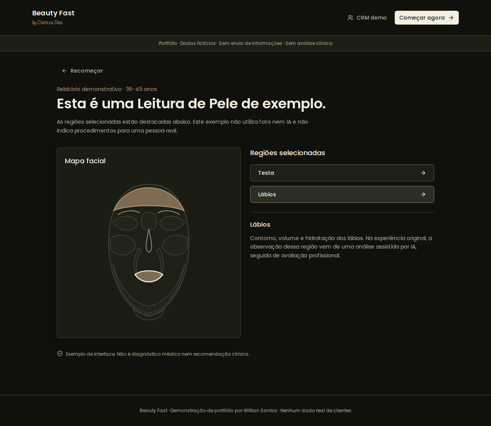
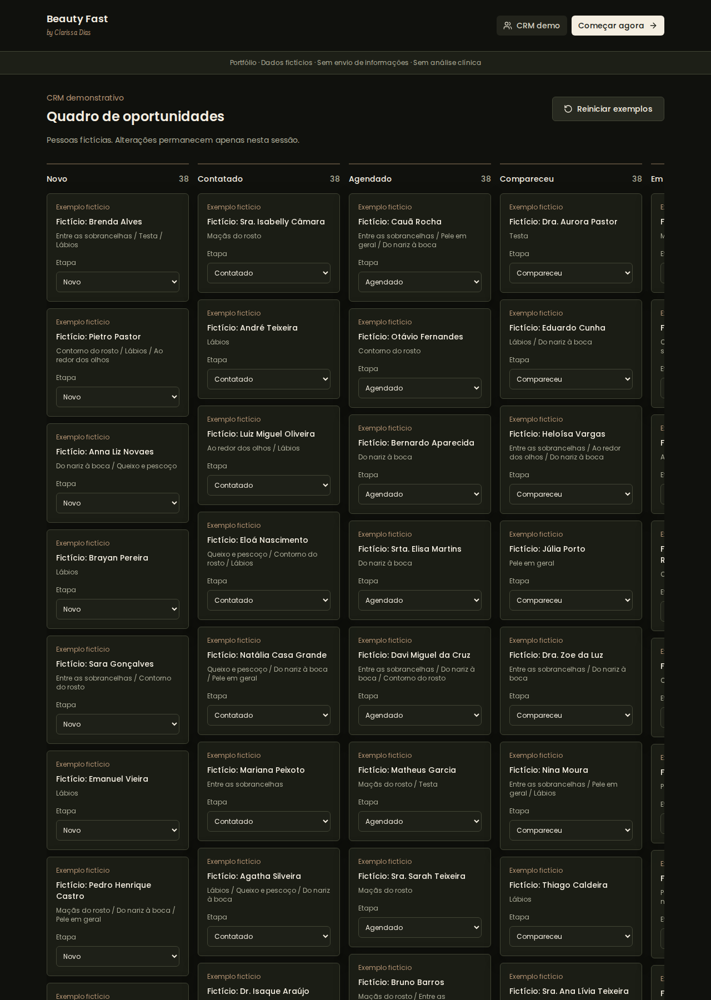

# Beauty Fast — Facial Guidance & CRM

**A privacy-safe product case study by Willian Santos.**

Beauty Fast connects an accessible facial-guidance experience with an organized lead pipeline. This public repository is a standalone portfolio demo, not the clinic's operational application.

## Problem

People considering aesthetic procedures often do not know the anatomical vocabulary needed to describe their concerns. Meanwhile, clinic teams need structured context before following up, rather than starting every conversation from scratch.

The original product addresses this through visual region selection, an AI-assisted report and a CRM workflow. The public demo showcases those interaction patterns without exposing clients, photos, credentials or production connections.

## Architecture

```text
PUBLIC PORTFOLIO — no production connections

Python + Faker (seeded)
       |
       v
300 synthetic leads (JSON) ---> React CRM ---> session-only status changes
                                   |
HashRouter ---> age + region selection ---> local illustrative report
                                               |
                                               v
                                     interactive SVG facial map

ORIGINAL PRODUCT — described only, not deployed from this repository

Visitor ---> questionnaire + consent + photo
                       |
                       v
             validated server functions
                 /               \
                v                 v
       Lovable AI Gateway     protected lead storage
                |                 |
                v                 v
       sanitized report       role-controlled CRM / agent tools
```

The portfolio runtime has no database client, outbound API calls, persistent browser storage, personal-contact fields or photo uploads. Synthetic data is bundled at build time; status changes reset on reload.

## Stack

| Layer | Technologies |
| --- | --- |
| Interface | React 18, TypeScript, Vite |
| Styling & controls | Tailwind CSS, semantic CSS tokens, Radix Slot, Lucide |
| Navigation | React Router / HashRouter |
| Visualization | Interactive SVG facial zones |
| Synthetic data | Python, Faker (`pt_BR`), seeded random generation, JSON |
| Verification | Node test runner, Python unittest, Playwright, GitHub Actions |
| Original production integrations | Lovable AI Gateway, Lovable Cloud, protected server functions and agent tools; excluded from this demo |

## Screenshots — synthetic data only

The screenshots below are captured from this repository's demo, not the production CRM. Names in the CRM are generated by Faker and visibly marked fictitious.

### Interactive report



### CRM with 300 synthetic opportunities



## Python evidence: 300 synthetic leads

[`scripts/generate_synthetic_leads.py`](scripts/generate_synthetic_leads.py) uses Faker, a fixed seed and a fixed reference date to generate a reproducible dataset. No production records are used as inputs.

- Default output: **300 leads**; supported range: **200–500**.
- Fields: synthetic ID, explicitly fictional name, facial interests, CRM status, age band and a `synthetic: true` marker.
- No phone numbers, email addresses, customer photos or actual case histories.
- Eight CRM statuses and nine facial regions.
- Output: [`src/data/synthetic-leads.json`](src/data/synthetic-leads.json).
- Tests verify exact record counts, uniqueness, reproducibility, fictional markers, valid statuses and accepted count boundaries.

```sh
python -m pip install -r requirements.txt
python scripts/generate_synthetic_leads.py --count 300 --seed 42
python -m unittest discover -s tests -p 'test_*.py'
```

## Results from production

> **Transparency note:** No verified aggregated production measurements were supplied for this portfolio. The numbers below are an **illustrative, fabricated scenario**, not observed production results, not testimonials, and not evidence of clinical or commercial impact. They must not be quoted as real deployment outcomes.

The example demonstrates how a copilot evaluation could be reported. Its fixture is stored separately in [`docs/illustrative-copilot-results.json`](docs/illustrative-copilot-results.json), explicitly marked synthetic. It is independent of the 300 fictional CRM leads.

| Copilot metric | Illustrative value — NOT production evidence |
| --- | --- |
| Evaluation cases | n = 19 synthetic examples |
| Example runs completed | 18/19 (94.7%) |
| Example outputs meeting the structured-report check | 16/19 (84.2%) |
| Example drafts accepted by a reviewer | 15/19 (78.9%) |
| Illustrative median handling time, baseline vs assisted | 420 s vs 180 s |
| Relative median time reduction in this example | 57.1% |

**Small-sample caveat (n = 19):** even a real evaluation of this size would be exploratory. One case changes a rate by approximately 5.3 percentage points. Without a documented sampling method, observation period, independent ground truth and controlled comparison, no causal improvement, generalizability or statistical significance should be claimed. Here the cases are invented, so these figures provide **no empirical evidence at all**.

To replace this example with actual production results, record the date range, inclusion criteria, metric definitions and denominators; publish only aggregates, never individual lead data.

## Run locally

Requires Node.js 20+ and Python 3.10+ for dataset generation.

```sh
python -m pip install -r requirements.txt
python scripts/generate_synthetic_leads.py --count 300 --seed 42
npm install
npm run dev
```

```sh
npm test
python -m unittest discover -s tests -p 'test_*.py'
npm run build
```

No `.env` is required. The **Refresh portfolio evidence** workflow regenerates the dataset, captures screenshots, runs checks and saves generated evidence to this repository.

## Privacy and scope

- Production app, CRM and private repository are unchanged.
- This demo does not perform medical analysis or recommend procedures for an actual person.
- No real clients, face photos, contact details, testimonials or production secrets are included.
- Generated names may coincidentally resemble real people; each record is created independently and explicitly marked fictional.
- The README describes the original product architecture, while the runnable public implementation remains local-only.

## Ownership

Code presented for portfolio review. Beauty Fast by Clarissa Dias and its branding belong to their respective owners. This repository does not grant commercial rights to the brand.
